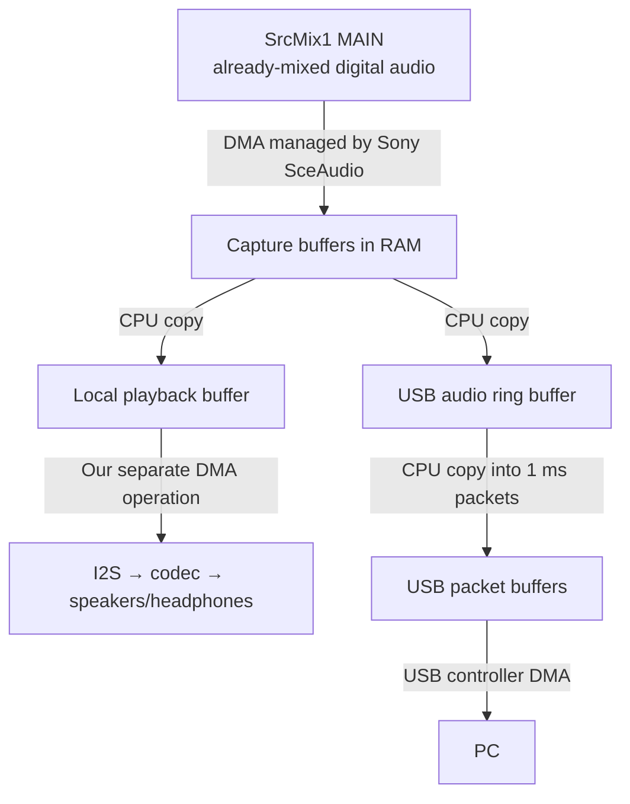

# vitastream

USB video and audio streaming for PS Vita, based on
[vita-udcd-uvc](https://github.com/xerpi/vita-udcd-uvc) by
[Xerpi (Sergi Granell)](https://github.com/xerpi), who created the original
USB video streaming plugin.

## What's this?

This is a kernel plugin that lets you stream your PSVita screen and its final
software audio mix to your computer via USB.

## How does it work?

The plugin uses the [SceUdcd](https://wiki.henkaku.xyz/vita/SceUdcd) module of the PSVita OS to setup
the necessary USB descriptors to simulate and behave as an [USB Video Class](https://en.wikipedia.org/wiki/USB_video_device_class) device (like a webcam or an USB video capture card).

The [hardware color space converter](https://wiki.henkaku.xyz/vita/IFTU_Registers) of the PSVita's SoC is used to perform the conversion to the destination pixel format; then the USB
controller directly performs a DMA transfer from the physical address of the resulting converted framebuffer, and therefore, saving CPU usage and power consumption.

Audio is exposed to the computer as a USB Audio Class 1.0 capture/input device
using 48 kHz, stereo, signed 16-bit PCM. Version 2.3 uses SceAudio's
firmware-owned monitor on SourceMixer1 MAIN, restoring the capture path used in
1.9 for system, PSP and application audio. The firmware manages capture DMA
and its completion fence. The tap precedes the codec's analog volume and mute
settings. It does not capture the microphone.

Version 2.3 fixes PS1 audio crackling and capture stopping after launching
Everybody's Golf. It keeps Sony's upstream mixer forwarding active and holds
ordinary routing resets while capture owns the audio paths. When capture
stops, each path uses its latest accepted restoration request, with the
pre-capture mode as a fallback; newer owners keep their configuration.
See the [PS1 audio investigation](docs/ps1-audio-2026-11-04.md) and
[Everybody's Golf investigation](docs/everybodys-golf-audio-2026-11-04.md).

By default, local speaker/headphone playback remains enabled during USB audio
capture. The `speakers=on` option enables experimental DMA forwarding of the same
captured PCM to the native local I2S sink, without changing the USB mix or
reintroducing 2.0's incomplete secondary-output tap. Stopping capture fences
the forwarding DMA before restoring Sony's normal output route. Simultaneous
USB recording and local speaker playback have been confirmed on a retail 3.60
Vita; other models, firmware and headphone routing still need device testing.
See the [earlier issue investigation](docs/issues-test.md) for the source-specific
audio reports and remaining application checks.
The [retail verification report](docs/retail-validation-2026-11-03.md) records
the confirmed 3.60 video/audio result and its testing limits.

During USB audio capture with `speakers=on`, the data flow is:



The monitor interface lets SceAudio manage the mixer-to-RAM DMA transfer.
CPU copies between the RAM buffers are shown explicitly.

Unlike audio-capture plugins that hook individual audio ports as they are
opened and closed (BGM, sound effects, and similar sources), this plugin
captures the already-combined final digital mix immediately before it is
routed to the speaker/headphone codec. The USB stream therefore contains the
mix actually produced by the Vita instead of a best-effort reconstruction
performed by the plugin. Reconstructing the mix from separate ports can miss
audio, lose synchronization, or produce clicks, gaps, and other glitches.

## Firmware support

vitastream targets retail, testkit and devkit systems on firmware families
3.60, 3.61, 3.63, 3.65, 3.67, 3.68, 3.69, 3.70, 3.71, 3.72, 3.73 and 3.74.
Compatibility is checked against the loaded firmware modules, so spoofing the
reported system version does not select incorrect offsets. Unknown module
identities or mismatched code contexts are rejected before USB hooks or audio
DMA are installed.

Offline validation currently covers 31 external firmware/hardware combinations
and additional tool builds. Some kit release images remain unavailable, and
this is not a claim of hardware testing on every model and firmware. See the
[firmware compatibility report](docs/firmware-compatibility.md) for the exact
coverage matrix and validation commands.

## Supported formats and resolutions

### Audio

* 48 kHz stereo signed 16-bit PCM (1,536 kb/s)

### Video

* 960x544 @ 30 FPS and (less than) 60 FPS
* 896x504 @ 30 FPS and (almost) 60 FPS
* 864x488 @ 30 FPS and 60 FPS
* 480x272 @ 30 FPS and 60 FPS
* 1280x720 @ 30 FPS

## Download and installation

**Download**:

* [Version 2.3 downloads](https://github.com/devnoname120/vitastream/releases/tag/v2.3)

Use `vitastream.skprx` for normal operation. The plugin creates
`ur0:/tai/vitastream.cfg` on startup if it is missing, with the local screen and
speaker playback enabled. The supplied `vitastream.cfg` is also available as
an example.
`vitastream_diagnostic.skprx` adds logging for troubleshooting. Install only one
plugin variant. Use `screen=off` in the configuration to disable either an OLED
or LCD panel during capture; both builds support this setting.
The audio routing hook remains resident once installed; reboot when replacing
or removing the plugin.

Releases published before the rename contain `udcd_uvc.skprx`. Rename that
downloaded file to `vitastream.skprx` to use the installation paths below.

**Compilation**

* [vitasdk](https://vitasdk.org/) is needed.

### Video pipeline

The current source build keeps one owned kernel conversion buffer and, with
`lowmemory=off` (the default), borrows idle SceCamera backing for a second
buffer. The worker can convert the next frame while USB transmits the previous
one; only one USB video request is queued at a time. A buffer is not reused or
returned until its DMA completes, including after cancellation. No additional
framebuffer is allocated from the game's or shared PhyCont budgets.

`lowmemory=on` uses only the first buffer and skips camera borrowing and its
hooks. Unknown camera layouts or unavailable backing also retain one-buffer
capture. The borrowing backend is currently guarded for the verified retail
3.60 Camera/Sysmem layout. Any camera app or game can reclaim its memory;
capture falls back to one buffer and retries once per second after the driver
becomes idle. See the [camera buffering notes](docs/video-camera-borrow.md) for
ownership checks, recovery and hardware-test coverage.

Use 960x544 on the tested retail setup. Its first buffer needs 1 MiB of physical
kernel backing. A 1280x720 selection needs 2 MiB, which did not fit in the
measured kernel pool; borrowing the second buffer does not fix the first
allocation. All advertised video modes and USB audio are retained.

The published version 2.3 downloads use a single kernel buffer. Camera-backed
buffering is newer source work. To build the current normal and diagnostic
variants with VitaSDK:

```sh
./gen_builds.sh builds/release
```

Run `make clean` before switching build options. Idle capture releases the
owned buffer and returns any borrowed camera memory. Overlap does not increase USB bandwidth;
its effect depends on the selected mode and host. See the
[hardware test report](docs/performance-2026-09-19.md) for measured capture rates
and the remaining testing limits. The overlap is adapted from
[trap15's change](https://github.com/trap15/vita-udcd-uvc/commit/2ad09ffa8453d8b0ea5bc283566bd25155832236),
with explicit buffer ownership and without removing 720p. Video remains
uncompressed NV12, using IFTU and USB DMA.

Before conversion, capture validates the source format and geometry, retains
the source process and memory, and rechecks the physical addresses. References
are released after synchronous IFTU conversion. A stale or unsupported source
is skipped so application or camera transitions do not send an unchecked
surface to IFTU.

Capture pacing uses integer arithmetic at the nominal 60 Hz vblank cadence.
It tolerates either rounding of the supported frame intervals, retains the
fractional remainder, and coalesces delayed notifications instead of queuing
stale captures. Timing changes take effect on COMMIT, not while the host is
still probing, and a new COMMIT resets the pacing phase.

### Host tests

```sh
make test
```

The tests require Python 3, POSIX threads and a native C compiler supporting
AddressSanitizer and UndefinedBehaviorSanitizer. They exercise the production video transport,
capture scheduling, source references, USB recovery, audio backend and shutdown
path with simulated firmware/kernel/USB dependencies, including audio route
ownership and concurrent routing requests during capture cleanup.
They do not replace device tests of IFTU, USB timing, or simultaneous audio.

### Configuration

The plugin automatically creates `ur0:/tai/vitastream.cfg` on startup when it
is missing. Screen, speakers and `nosleep` default to on; low-memory mode defaults to off:

```ini
screen=on
speakers=on
lowmemory=off
nosleep=on
```

- `screen=off` turns off the local OLED/LCD panel while the host captures video
  and/or audio. USB video continues. The panel and saved brightness are restored
  after capture stops or disconnects. `screen=on` leaves the panel alone.
- `speakers=on` forwards captured PCM to the selected local output, so USB
  recording and local speaker/headphone playback can run together. It uses a
  private 4 KiB buffer, one PCM copy per block, and destination-paced DMA rather
  than a software mixer or resampler. The retail 3.60 speaker path has been
  tested; wider hardware and firmware validation remains experimental.
  `speakers=off` retains the existing USB-only audio path.
- `lowmemory=on` uses one video buffer and disables camera-memory borrowing.
  `lowmemory=off` enables the optional second buffer, with automatic fallback
  and recovery when another app uses the camera. `1` and `0` are also accepted
  for this option.
- `nosleep=on` prevents automatic suspend while USB video and/or audio capture
  is active. It refreshes only the automatic-suspend idle timer, at most once
  per second. When capture stops it stops refreshing the timer, allowing normal
  automatic suspend again. It does not override the panel setting or block
  manual sleep. `nosleep=off` leaves the suspend policy alone. `1` and `0` are
  also accepted for this option.

The file is read on plugin startup; reboot after editing it. `#` and `;` start
comments. Keys and `on`/`off` values are case-insensitive. Existing files are
preserved. Files without `lowmemory` use its default of off; files without
`nosleep` use its default of on. An unreadable or invalid file uses these same
defaults. The same defaults apply if the file cannot be created.

**Installation**:

1. Copy `vitastream.skprx` to your PSVita
2. Add `vitastream.skprx` to taiHEN's config (`ur0:/tai/config.txt` or `ux0:/tai/config.txt`):
```
*KERNEL
ur0:tai/vitastream.skprx
```
3. Reboot your PSVita.

When upgrading from vita-udcd-uvc, replace its existing kernel plugin entry with
`vitastream.skprx` so only one streaming plugin is loaded. New builds identify
the USB video and audio device as `vitastream` on your computer.

## Listening to audio on macOS

On macOS, FFmpeg versions older than 8.1.3 have an audio bug that prevents
sound from working correctly. Upgrade to FFmpeg 8.1.3 or later.

## Troubleshooting

If capture falls below the requested frame rate, try a USB port on a different
host-controller path and avoid external hubs. A physically direct connection
can still traverse an internal hub. On the tested Mac mini, moving the same
Vita, cable and adapter from a front port to a rear port increased native
video-only capture from about 52.15 to 57.45 FPS with the same plugin binary.
This is not a universal port-performance guarantee; see the
[USB ceiling measurements](docs/usb-ceiling-2026-09-19.md) for the topology,
static/raw transfer tests and limitations.
The [firmware follow-up](docs/usb-firmware-2026-09-19.md) covers device-side
request sizes, the verified DMA path, and the remaining controller unknowns.

If the video looks glitched, try to change the video player configuration to use the *NV12* format or switch to another player (like PotPlayer or OBS). If the colors look wrong, set color range to full and color space to BT.601 (Rec. 601).

If you use Windows 10 you might have to change the Camera access permissions on the Privacy Settings.

On Linux I recommend using *mplayer* (`mplayer tv:// -tv driver=v4l2:device=/dev/videoX:width=960:height=544`).

USB audio requires the firmware monitor route to be available. Capture rejects
an already-active monitor or Bluetooth route instead of replacing its owner.
Disable that route before retrying USB audio if necessary.

VitaShell USB storage temporarily takes over the USB controller. Once storage
stops and VitaShell attempts to restore MTP, the worker restarts vitastream
automatically when the bus is available. The restart request survives cable
disconnection and temporary failures; the device can be armed while unplugged.
Stopping storage while unplugged and then reconnecting does not require a
reboot. Reconnecting while storage is still active does not take the controller
away from storage. The host may need to reopen its capture device after
re-enumeration. Repeated storage handoff and automatic restoration were
confirmed on a PS Vita 1000 running firmware 3.65; other hardware and firmware
remain unverified.

Note: Remember that if anything goes wrong (like PSVita not booting) you can always press L at boot to skip plugin loading.

## License

vitastream is licensed under the [GNU General Public License v3.0](LICENSE).

## Projects using vitastream

* [VitaDock++](https://github.com/Streety-1/VitaDockPlusPlus) turns a Raspberry Pi 5 into a TV dock for the PS Vita, using vitastream for USB video and audio.
